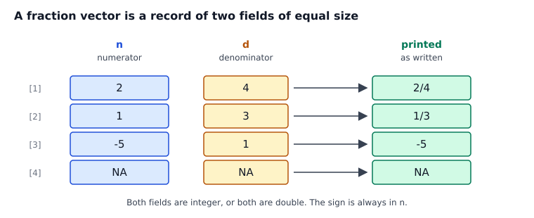
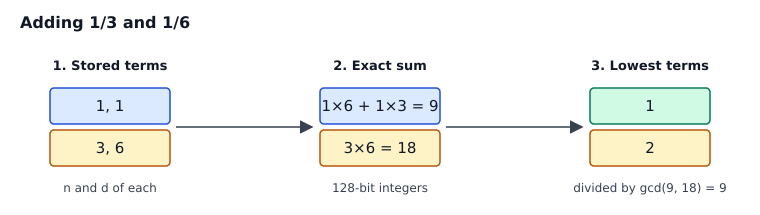
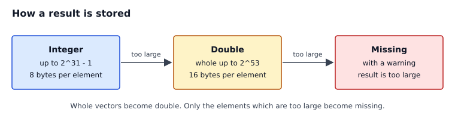

```{r, include = FALSE}
knitr::opts_chunk$set(
  collapse = TRUE,
  comment = "#>"
)
```

```{r setup}
library(fraction)
```

## The problem

Most fractions can't be stored exactly as a number, so arithmetic with them is approximate.

```{r problem}
1 / 10 + 2 / 10 == 3 / 10

fraction(1, 10) + fraction(2, 10) == fraction(3, 10)
```

A number also forgets how it was written: 3 out of 10 and 30 out of 100 are both `0.3`. The fraction package stores the numerator `n` and denominator `d` separately, which keeps both the exact value and the terms it was written in.

## Data structure

A `fraction` is a vctrs record with two fields. It works like any other vector, including in data frames.

{width=100%}

```{r rcrd}
x <- fraction(c(2, 1, -5, NA), c(4, 3, 1, 1))
x
numerator(x)
denominator(x)
```

A denominator of zero is allowed: `1/0`, `-1/0` and `0/0` behave as `Inf`, `-Inf` and `NaN`.

## Converting

`as_fraction()` reads text, and approximates numbers which aren't whole.

```{r convert}
as_fraction(c("2/4", "3", "1 3/4"))
as_fraction(c(0.1, 0.75, 1 / 3))
as_fraction(pi, max_d = 1000)
as.double(fraction(1, 3))
```

## Arithmetic

Fractions are kept as written, but results are in lowest terms. `simplify()` reduces a fraction without calculating anything.

{width=100%}

```{r arith}
fraction(1, 3) + fraction(1, 6)
fraction(2, 3)^-2
simplify(fraction(2, 4))
sum(fraction(1, 1:10))
mean(fraction(1:3, 4))
round(fraction(2, 3), 2)
```

Functions with results that usually aren't fractions, such as `sqrt()` and `exp()`, give doubles.

## Plain numbers

Whole numbers are fractions. If any element of a plain number isn't whole, the result is a double, as it is when adding an integer to a double. Convert with `as_fraction()` first to remain exact.

```{r plain}
fraction(1, 3) + 1
fraction(1, 3) + 0.5
fraction(1, 3) + as_fraction(0.5)
```

The type made by combining vectors can't depend on their values, so combining with any double gives doubles. Use integers (such as `1L`) or `as_fraction()` to combine as fractions.

```{r combine}
c(fraction(1, 3), 1)
c(fraction(1, 3), 1L)
```

## Comparison

Comparisons use the exact value, regardless of the terms. So do sorting, matching and grouping.

```{r compare}
fraction(2, 4) == fraction(1, 2)
unique(fraction(c(2, 1, 1), c(4, 2, 3)))
sort(fraction(c(2, 1, 5), c(3, 2, 8)))
```

## Storage

The fields are integers if both inputs are integers, and otherwise doubles. Note that `1` is a double and `1L` is an integer. Integers become doubles when a result doesn't fit, and results too large for doubles are missing.

{width=100%}

```{r storage, warning = TRUE}
x <- fraction(.Machine$integer.max, 2L)
x
x * 3L
fraction(1, 2^53) / 3
```

Denominators grow quickly when adding fractions with many different denominators. Use `as.double()` for approximate results of any size.

```{r large}
sum(fraction(1, 1:40))
sum(as.double(fraction(1, 1:100)))
```
